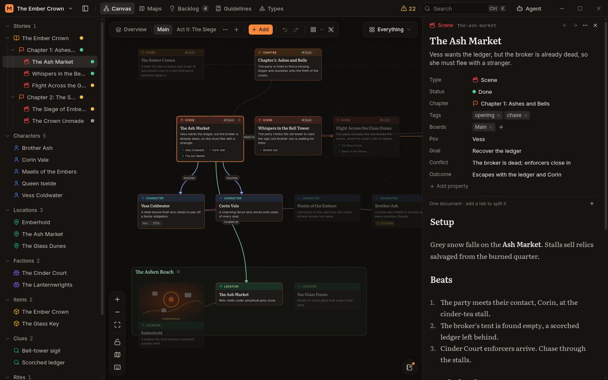
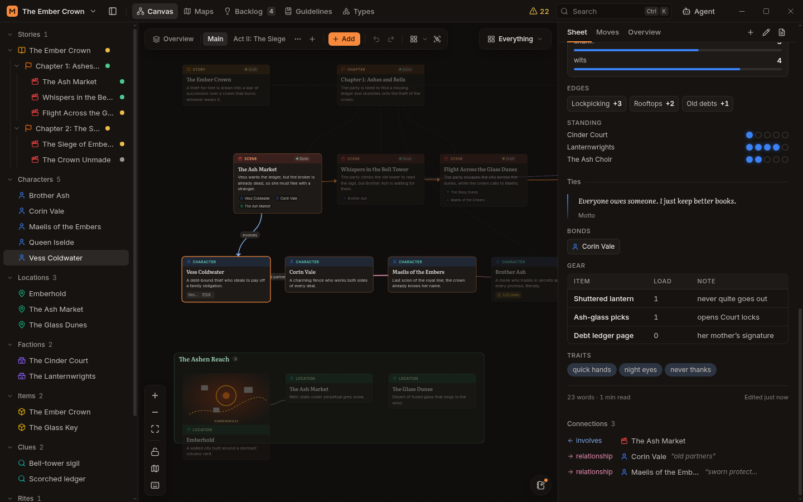
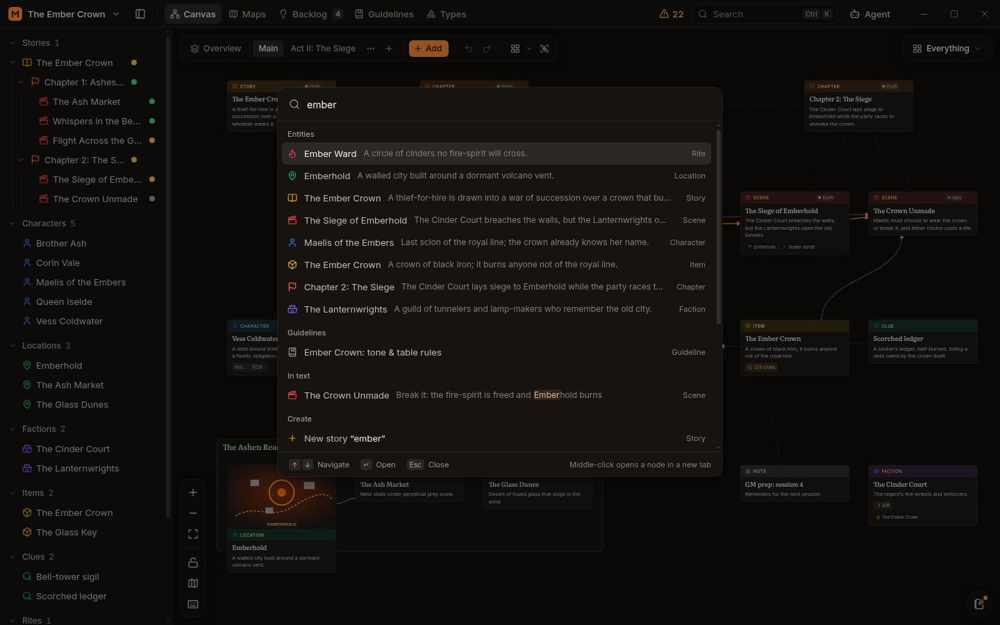
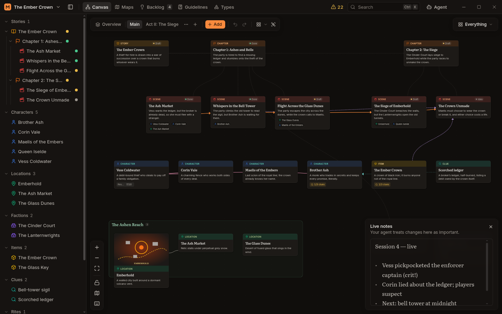

# Maquest

**Write stories, novels, screenplays and RPG campaigns with your AI agent.**
Your agent (Claude Code, Codex, Cursor…) edits the project over MCP. You watch it land live on a canvas.



## Why

- 🧠 **Agent-first** — built-in MCP server, no chat UI to babysit
- ⚡ **Live** — every agent edit shows up instantly
- 📁 **Plain files** — markdown + JSON in a folder, git-friendly
- 🎲 **Any genre** — no game system baked in

## Features

- **Canvas** — stories → chapters → scenes, characters, locations, factions, items, notes, typed connections
- **Sheets** — custom fields per type: meters, clocks, radar charts, tables, searchable records
- **Checks** — lint your project: broken links, missing fields, orphan nodes, quick fixes
- **Guidelines** — writing rules + an "Author's style" the agent learns from your edits
- **Backlog** — dump raw ideas, promote them later
- **Media** — images and videos on the canvas and in docs

| Sheets                                    | Command palette                             |
| ----------------------------------------- | ------------------------------------------- |
|  |  |



## Quick start

1. [Download](https://github.com/Angael/maquest/releases) (Windows x64, Linux AppImage)
2. Create a project in the app
3. Run your agent in the folder:

```sh
cd my-campaign
claude   # or codex / cursor
```

## Shortcuts

| Key               | Does              |
| ----------------- | ----------------- |
| `Ctrl/⌘ K`        | Search + commands |
| `Ctrl/⌘ /`        | All shortcuts     |
| `A` / right-click | Add node          |
| `[[`              | Link a node       |
| `Ctrl/⌘ Z`        | Undo              |

## Develop

```sh
pnpm install
pnpm dev
pnpm check        # lint, tests, Electron e2e (Xvfb on Linux)
pnpm screenshots  # capture UI into .screenshots/
```

- Architecture → [AGENTS.md](AGENTS.md)
- Releases → [.changeset/README.md](.changeset/README.md)
